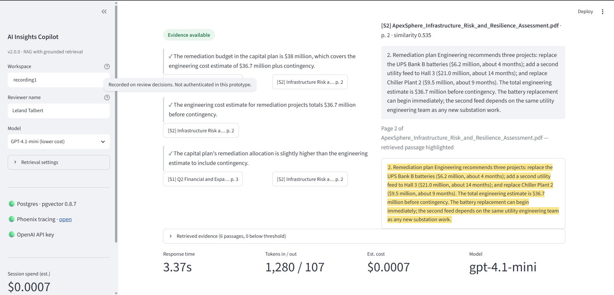
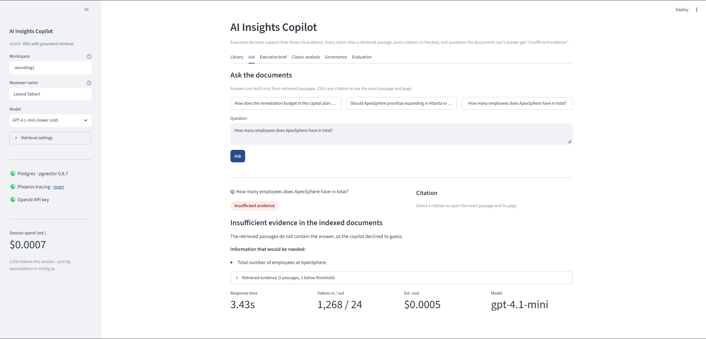
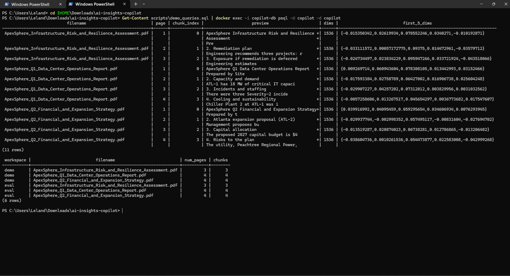
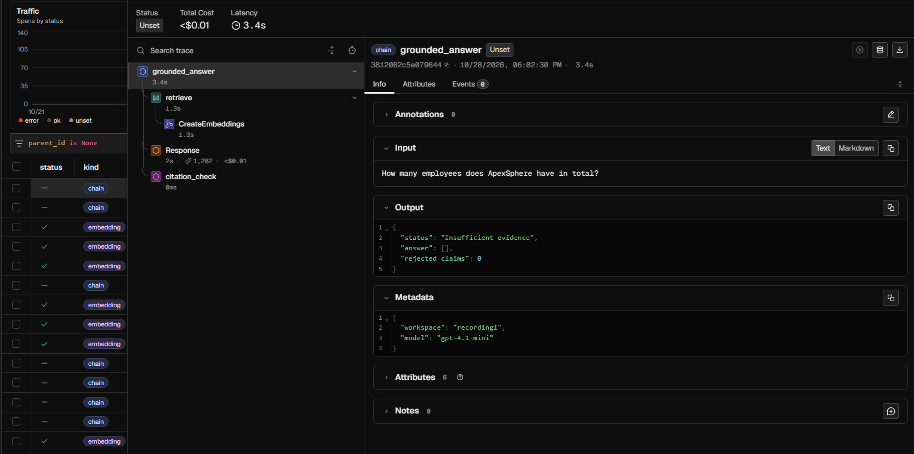
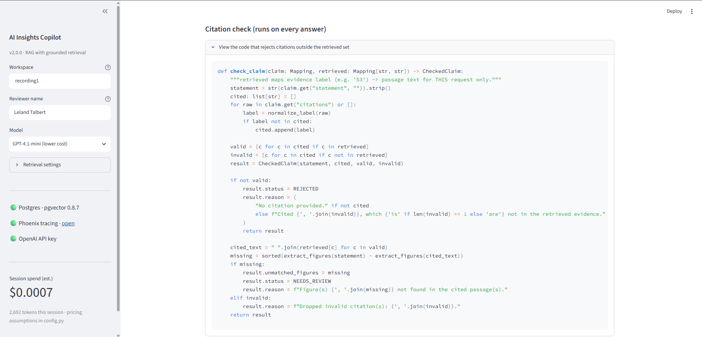
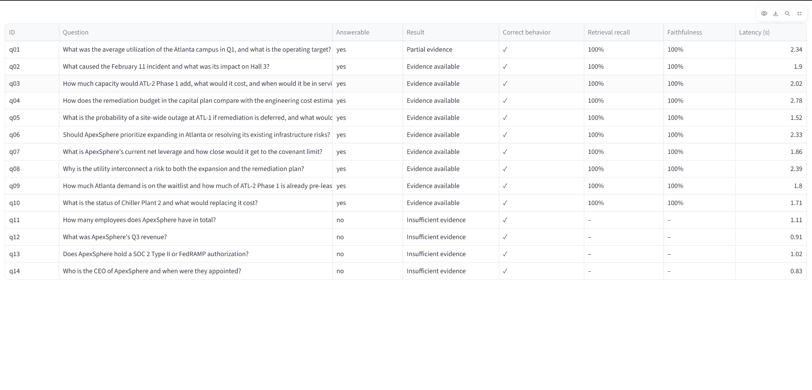
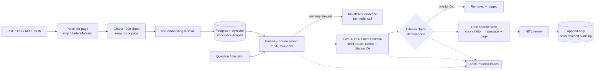

# AI Insights Copilot v2 — RAG with Grounded Retrieval


An applied GenAI decision-support prototype that turns document collections into executive briefs **whose every claim can be traced to a specific passage and page** — and that says *"insufficient evidence"* instead of guessing.

Version 2 adds Retrieval-Augmented Generation (RAG) on Postgres + pgvector, a deterministic citation check, OpenTelemetry tracing to Arize Phoenix, and an evaluation suite, while keeping v1's audience views, human-in-the-loop review, structured JSON output and cost tracking.

> All demo documents describe **ApexSphere**, a fictional company. Do not index real employer, client or sensitive data into this prototype.

### ▶ Demo video (4 minutes)

[](https://youtu.be/mVq__cJ01U0)

**[Watch the v2 walkthrough](https://youtu.be/mVq__cJ01U0)** (best viewed full screen at 1080p) — document ingestion, a cross-document question with click-through citations, the citation check, an "insufficient evidence" response, Arize Phoenix traces, and the evaluation run.

### Evaluation baseline (GPT-4.1-mini, 14 fixed questions)

| Retrieval recall | Faithfulness | Answered when answerable | Declined when unanswerable | Cost per run |
|:---:|:---:|:---:|:---:|:---:|
| 100% | 100% | 10 / 10 | 4 / 4 | $0.017 |

Full results: [`evals/results/latest.json`](evals/results/latest.json). This is a small, purpose-built baseline on three fictional documents; its value is that every change can be measured against it.

### Screenshots

| Cross-document answer with click-through citation | "Insufficient evidence" instead of a guess |
|---|---|
|  |  |
| **Chunks, metadata and 1,536-dim vectors in pgvector** | **Arize Phoenix trace: retrieval, model call, citation check** |
|  |  |
| **Deterministic citation check (no model involved)** | **Evaluation run** |
|  |  |

### Version history

- **v2 (current)** — RAG with grounded retrieval, citation validation, observability and evaluation.
- **v1** — single-document analysis with audience views and human-in-the-loop review. Code snapshot under the [`v1.0` tag](../../tree/v1.0); [v1 walkthrough on LinkedIn](https://www.linkedin.com/feed/update/urn:li:activity:7406702198795153408/). v1 images remain in [`docs/images`](docs/images).

---

## What changed from v1

| Capability | v1 | v2 |
|---|---|---|
| Document handling | One document, full text sent to the model | Multi-document library, page-level chunks with document + page metadata |
| Storage | Session state only | **Postgres + pgvector** (HNSW cosine index), workspace-isolated |
| Evidence | Optional follow-up call asking the model for excerpts | Answers built only from retrieved passages, each claim cites passage IDs |
| Citation verification | None | **Deterministic check**: citations outside the retrieved set are removed; figures must appear in cited text |
| Unanswerable questions | Model may still answer | Three gates → **"Insufficient evidence"** with what's missing |
| Confidence | Model-generated certainty score | **Evidence status** from explicit checks (Available / Partial / Insufficient) |
| Human review | Approve / refine + comments in session | Same, plus **append-only, hash-chained audit trail** in Postgres |
| Observability | None | **Arize Phoenix** traces: retrieval, prompt, tokens, latency, guardrail |
| Evaluation | None | 14-question suite: retrieval recall, faithfulness (LLM judge), abstention |
| Cost | ~4 chars/token estimate | Computed from token counts the API reports |
| Model providers | OpenAI | OpenAI (Responses API) or a **local model via Ollama** |

The v1 single-document analysis is still available in the **Classic analysis** tab for side-by-side comparison.

---

## Architecture



### The three gates against unsupported answers

1. **Retrieval gate** — if no passage clears the relevance threshold (`MIN_SIMILARITY`), the app answers "insufficient evidence" *without calling the model*.
2. **Model gate** — the model must return `insufficient_evidence` when the passages don't answer the question, and list what's missing.
3. **Citation check** (`copilot/citations.py`) — runs on every answer, no model involved:
   - a citation must name a passage that was actually retrieved for *this* request; anything else is rejected;
   - a claim with no valid citation is removed from the answer (and shown in a "Removed by citation check" panel);
   - every figure in a claim must appear in the passages it cites, or the claim is flagged *Needs review*.
   If no claim survives, the answer becomes "insufficient evidence".

Documents are treated as untrusted data: passages are wrapped in `<evidence>` tags that documents cannot forge, and the model is instructed to ignore instructions inside them.

---

## Quick start

**Requirements:** Python 3.11+ (built on 3.13), Docker, an OpenAI API key.

```bash
# 1. Infrastructure: Postgres + pgvector and Arize Phoenix
docker compose up -d

# 2. Python environment
python -m venv .venv && source .venv/bin/activate   # Windows: .venv\Scripts\activate
pip install -r requirements.txt

# 3. Configuration
cp .env.example .env        # then set OPENAI_API_KEY

# 4. Run
streamlit run app.py
```

- App: http://localhost:8501
- Phoenix traces: http://localhost:6006 (project `ai-insights-copilot`)

In the app, open **Library → Load ApexSphere sample set** to index the three fictional documents.

### Optional: local model via Ollama

```bash
ollama pull llama3.1:8b
```
Then pick **Local model via Ollama** in the sidebar. Generation runs locally at $0 API cost; embeddings still use OpenAI so the same index works for both. Smaller local models follow the JSON schema and citation rules less reliably — the citation check catches what they get wrong.

---

## Using the app

| Tab | What it does |
|---|---|
| **Library** | Upload/index documents, inspect chunks by page, delete documents, and see the pgvector rows (SQL + vectors) |
| **Ask** | Grounded Q&A. Each claim shows its citations; click one to open the exact passage with its full page highlighted |
| **Executive brief** | Summary, risks, opportunities and recommendations for CEO/Board, CTO, COO, CFO or Analyst; per-section evidence status; human review and regeneration with reviewer guidance |
| **Classic analysis** | The v1 single-document analysis, kept for comparison |
| **Governance** | The controls, the citation-check source code, and the audit trail with hash-chain verification and export |
| **Evaluation** | Run the 14-question suite and view retrieval recall, faithfulness and abstention results |

### Audience views

| Audience | Sees |
|---|---|
| CEO / Board | Top 3 items per section, decision readiness, source count — no retrieval diagnostics |
| CTO | Up to 5 items, passages, retrieval diagnostics, removed claims |
| COO | Up to 5 items with operational evidence and dependencies |
| CFO | Up to 5 items with financial evidence, tokens and cost |
| Analyst / Practitioner | Everything: all items, passages, similarity scores, removed claims, cost |

Audience selection changes both retrieval (an audience-specific second query) and presentation.

---

## Evaluation

```bash
python evals/run_eval.py                  # GPT-4.1-mini
python evals/run_eval.py --model gpt-4.1
python evals/run_eval.py --model ollama   # local generation, OpenAI judge
```

`evals/questions.json` holds 14 questions about the ApexSphere set: 10 answerable (6 of them need two or three documents) and 4 the documents cannot answer. Each answerable question lists the document and page that contain the answer.

| Metric | How it's measured |
|---|---|
| Retrieval recall | Share of expected (document, page) pairs found among retrieved passages |
| Faithfulness | Share of displayed claims an LLM judge rates fully supported by their cited passages |
| Abstention | Answerable questions answered; unanswerable ones return "insufficient evidence" |
| Citation rejects | Claims the deterministic check removed |

Results are written to `evals/results/latest.json` and shown in the Evaluation tab; each case is traced in Phoenix. The LLM judge is itself a model and can err — treat faithfulness as a monitoring signal, not ground truth.

---

## Where the data lives

```sql
SELECT d.filename, c.page, c.chunk_index, left(c.content, 60) AS preview,
       vector_dims(c.embedding) AS dims, (c.embedding::real[])[1:5] AS first_5_dims
FROM chunks c JOIN documents d ON d.id = c.document_id
WHERE c.workspace = 'demo'
ORDER BY d.filename, c.chunk_index;
```

Run `docker exec -i copilot-db psql -U copilot -d copilot < scripts/demo_queries.sql`, or open **Library → Where is it stored?** in the app. Schema: `db/schema.sql` (`documents`, `segments` for full page text, `chunks` with `vector(1536)`, `audit_log`).

---

## Project structure

```
app.py                      Streamlit UI
copilot/
  config.py                 Settings (env-driven), models, pricing assumptions
  ingest.py                 PDF/TXT/MD/JSON parsing, header/footer stripping, page-level chunking
  embeddings.py             OpenAI embeddings
  store.py                  pgvector storage, workspace-scoped search
  indexing.py               Parse → chunk → embed → store
  rag.py                    Retrieval, evidence formatting, grounded Q&A (three gates)
  citations.py              Deterministic citation check and evidence status
  brief.py                  Audience-specific grounded executive brief
  audiences.py              get_audience_config()
  classic.py                v1 single-document analysis
  llm.py                    OpenAI Responses API / Ollama provider layer, JSON repair
  audit.py                  Append-only, hash-chained review trail
  tracing.py                Phoenix / OpenInference tracing
  evaluation.py             Retrieval, faithfulness and abstention evaluation
  cost.py                   Usage and cost accounting
db/schema.sql               Tables, HNSW index, audit triggers
evals/                      questions.json, run_eval.py, results/
sample_docs/                Three fictional ApexSphere PDFs (regenerate: scripts/make_sample_docs.py)
scripts/demo_queries.sql    SQL for the storage walkthrough
tests/                      Unit tests + integration tests against real pgvector
```

## Tests

```bash
docker compose up -d db
pytest -q
```

Integration tests run against the real database with an offline embedder and scripted model responses, so they need no API key and cost nothing. They cover page metadata, workspace isolation, the citation check, all three insufficient-evidence gates, and audit-log immutability.

---

## Honest scope

This is a **prototype**, positioned as an applied GenAI decision-support and governance demonstration, not a production platform.

| Capability | Status |
|---|---|
| RAG with pgvector, page-level citations | Implemented |
| Deterministic citation validation | Implemented (ID membership + figure matching; it does not prove semantic support — the eval judge measures that) |
| Insufficient-evidence handling | Implemented (three gates) |
| Multi-document retrieval | Implemented |
| Tracing (Phoenix) | Implemented |
| Automated evaluation | Implemented (small fixed suite; LLM judge) |
| Append-only audit trail | Implemented — tamper-evident, not tamper-proof (a DB superuser can drop triggers) |
| Workspace isolation | Implemented at query level; no authentication yet |
| Authenticated reviewers / RBAC | Not implemented — reviewer names are self-reported |
| Hybrid (keyword + vector) search, reranking | Not implemented |
| OCR for scanned PDFs | Not implemented |
| Containerized app + CI | Not implemented (infrastructure runs in Docker) |
| Pluggable providers (Bedrock, etc.) | OpenAI and Ollama today; provider layer is isolated in `llm.py` |

### Next steps
1. Make the model provider swappable for Amazon Bedrock or other hosted models behind the same `llm.py` interface.
2. Containerize the app and add CI that runs the test suite and the evaluation on every change.
3. Hybrid search and a reranker; SSO-bound reviewer identities; WORM storage for audit hashes.
